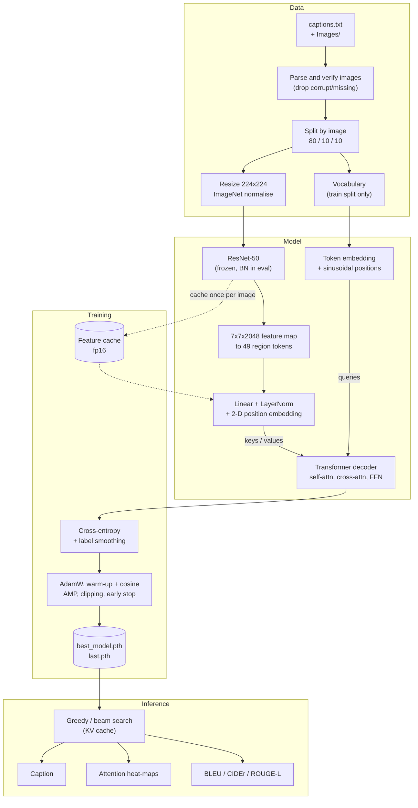

# 🖼️ Multimodal Image Captioning — ResNet-50 Encoder + Transformer Decoder

[](https://github.com/saumyadeepgain/multimodal-image-captioning/actions/workflows/ci.yml)


Generates English captions for images with a **ResNet-50** visual encoder and a **Transformer
decoder** that cross-attends over a 7×7 grid of image regions — and shows **where the model
looked** for every word. Trained on **Flickr8k** (8,091 images × 5 captions).

> Based on the idea of Xu et al., *Show, Attend and Tell* (2015), with a modern Transformer decoder.
> A step-by-step engineering report of every design decision is in
> [`docs/IMPROVEMENTS.pdf`](docs/IMPROVEMENTS.pdf).

## ✨ Key features

- **Model** — frozen ResNet-50 (optional layer4 fine-tuning) → 49 region tokens with learned 2-D
  positions → Pre-LN Transformer decoder; KV-cached greedy and **batched beam search**.
- **Interpretability** — per-word cross-attention heat-maps with attention entropy.
- **Fast training** — CNN features cached once per image (**~11× faster** epochs), AMP
  (bf16 / fp16 + `GradScaler`), gradient accumulation, warm-up + cosine LR, early stopping.
- **Reproducible** — one typed YAML config (every key is also a CLI flag), seeded everything,
  config stored in each checkpoint, **bit-exact resume** after interruption.
- **Robust** — corrupted/missing images handled, CUDA OOM recovered by exact micro-batching,
  automatic `cuda` → `mps` → `cpu` selection, readable errors.
- **Honest evaluation** — corpus BLEU-1…4, CIDEr-D and ROUGE-L against all 5 references
  (built in and verified against `pycocoevalcap`), leak-free split by image.
- **Tooling** — standalone inference CLI (files or folders → text / JSON / CSV + figures),
  Gradio demo, TensorBoard / W&B, Docker, Makefile, 89 tests, ruff, GitHub Actions CI.

---

## 🔀 Pipeline



---

## ⚙️ Setup

```bash
git clone https://github.com/saumyadeepgain/multimodal-image-captioning.git
cd multimodal-image-captioning
python -m venv .venv && source .venv/bin/activate        # Windows: .venv\Scripts\activate
pip install -r requirements.txt --extra-index-url https://download.pytorch.org/whl/cpu
pip install --no-deps -e .
```

`requirements.txt` pins the exact versions the tests ran against. Drop the `--extra-index-url`
(or use a CUDA index such as `.../whl/cu126`) to get GPU wheels. Optional extras are pinned in
`requirements-optional.txt` (Gradio demo, TensorBoard, W&B, METEOR, notebook) and dev tools in
`requirements-dev.txt`. With `make`: `make install-cpu`, `make install-dev`, `make install-all`.

**Dataset** — download [Flickr8k from Kaggle](https://www.kaggle.com/datasets/adityajn105/flickr8k)
and extract it so that you have:

```
data/archive/Images/        # 8,091 .jpg files
data/archive/captions.txt   # "image,caption" lines (Flickr8k.token.txt also works)
```

---

## 🚀 Usage

| Task | Make | Plain command |
|---|---|---|
| Train | `make train` | `python -m src.train --config configs/default.yaml` |
| Train with overrides | `make train ARGS="--epochs 30 --lr 1e-4"` | `python -m src.train --epochs 30 --lr 1e-4` |
| Resume | `make resume` | `python -m src.train --config checkpoints/config.yaml --resume checkpoints/last.pth` |
| Evaluate (test split) | `make eval` | `python -m src.evaluate --checkpoint checkpoints/best_model.pth --split test --beam 3` |
| Caption one image | `make predict INPUT=photo.jpg` | `python -m src.predict photo.jpg` |
| Caption a folder | `make predict INPUT=photos/ ARGS="-r --format csv -o captions.csv"` | `python -m src.predict photos/ -r --format csv -o captions.csv` |
| Attention figures | `make predict INPUT=photos/ ARGS="--save-attention viz/"` | `python -m src.predict photos/ --save-attention viz/` |
| Web demo | `make demo` | `python app.py --checkpoint checkpoints/best_model.pth` |
| Tests / lint | `make test` · `make lint` | `pytest` · `ruff check . && ruff format --check .` |

### Training

Every key in [`configs/default.yaml`](configs/default.yaml) is a flag — by short name when
unambiguous (`--lr`, `--epochs`, `--amp false`) or fully qualified (`--eval.batch_size 16`).
Precedence: defaults < `--config` file < flags < `--set key=value`; values are type-checked and
the config is validated before anything loads.

| Flag | Effect |
|---|---|
| `--train_CNN` | fine-tune ResNet layer4 (disables the feature cache, enables augmentation) |
| `--grad_accum_steps 4` | effective batch = `batch_size × 4` |
| `--select_metric CIDEr` | keep the checkpoint with the best val `BLEU-4` / `CIDEr` / `val_loss` |
| `--patience 5 --min_delta 0.001` | early stopping |
| `--backend tensorboard` / `--backend wandb` | experiment tracking |
| `--device cpu` | force a device (default `auto`: cuda > mps > cpu) |
| `--stop_after_epochs 5` | stop after 5 epochs; continue later with `--resume` |

Outputs in `checkpoints/`: `best_model.pth` (weights + config + vocabulary), `last.pth`
(+ optimizer, scheduler, AMP scaler, RNG state, epoch, best metric), `config.yaml`,
`history.json`, `logs/train_<timestamp>.log` and optional `tensorboard/`.

### Inference

`src/predict.py` accepts files and/or folders, runs the model in eval mode, and writes
`text` (default), `json`, `jsonl` or `csv` to stdout or `--output`. Logs go to stderr, so the
output can be piped. Unreadable images are skipped with exit code 2.

```bash
python -m src.predict data/archive/Images/1000268201_693b08cb0e.jpg
python -m src.predict photos/ --recursive --beam 5 --format json --output captions.json
python -m src.predict photos/ --save-attention viz/    # viz/<name>_attention.png per image
```

### Docker

```bash
make docker-build                                    # docker build -t image-captioning .
make docker-train ARGS="--epochs 20"                 # data/ and checkpoints/ are mounted
make docker-eval
make docker-predict INPUT=data/my_photos/
make docker-build-demo && make docker-demo           # http://localhost:7860
```

The image is CPU-only by default (`python:3.12-slim` + CPU PyTorch). For CUDA, build with
`--build-arg TORCH_INDEX_URL=https://download.pytorch.org/whl/cu126` and run with `--gpus all`.

---

## 📊 Results

Fill these tables from `checkpoints/eval_results.json` (written by `make eval`) and
`checkpoints/history.json`. Report the split, decoding settings and hardware with every number.

### Benchmark (Flickr8k test split)

| Model | Encoder | Decoding | BLEU-1 | BLEU-2 | BLEU-3 | BLEU-4 | METEOR | CIDEr | ROUGE-L | ms / image | Params (trainable) |
|---|---|---|---|---|---|---|---|---|---|---|---|
| Xu et al. 2015, soft attention *(reference)* | VGG | beam | 67.0 | 44.8 | 29.9 | 19.5 | 18.9 | — | — | — | — |
| **This repo** — 3-layer Transformer | ResNet-50, frozen | greedy | — | — | — | — | — | — | — | — | — |
| **This repo** — 3-layer Transformer | ResNet-50, frozen | beam 3 | — | — | — | — | — | — | — | — | — |
| **This repo** — 3-layer Transformer | ResNet-50, layer4 fine-tuned | beam 3 | — | — | — | — | — | — | — | — | — |

<sub>Scores ×100. This repo uses a seeded random 80/10/10 split by image, not the Karpathy
split, so comparisons with papers are indicative only. Hardware: ____ · batch size: ____.</sub>

### Ablations (val split, beam 3)

| # | Variant | Change vs. baseline | BLEU-4 | CIDEr | Δ CIDEr | Train time / epoch | Notes |
|---|---|---|---|---|---|---|---|
| 0 | **Baseline** | `configs/default.yaml` | — | — | 0.0 | — | |
| 1 | Fine-tune CNN | `--train_CNN` | — | — | — | — | |
| 2 | Decoder depth | `--num_layers 6` | — | — | — | — | |
| 3 | Model width | `--embed_size 256` | — | — | — | — | |
| 4 | No label smoothing | `--label_smoothing 0` | — | — | — | — | |
| 5 | Tied embeddings | `--tie_weights` | — | — | — | — | |
| 6 | Greedy decoding | `--beam 1` (evaluate) | — | — | — | — | |
| 7 | Wider beam | `--beam 5` (evaluate) | — | — | — | — | |

### Measured so far (no Flickr8k GPU run yet)

**Speed, original code vs. this code** — CPU, 4 threads, batch 16, d=256
([`docs/benchmark_old_vs_new.py`](docs/benchmark_old_vs_new.py)):

| Operation | Original | Now | Speed-up |
|---|---|---|---|
| Training step, cached CNN features | 833 ms | 77 ms | **10.8×** |
| Greedy decoding, 16 images | 1,744 ms | 722 ms | 2.4× |
| Beam search k=5, 1 image | 343 ms | 85 ms | 4.0× |
| KV-cache vs. full-prefix decoding (d=512, 30 tokens) | 1,029 ms | 208 ms | 4.9× |

**Controlled ablation on a synthetic task** (3 seeds, [`docs/ablation.py`](docs/ablation.py)) —
validation cross-entropy, lower is better: untied output layer **0.256** (default) · tied
weights 0.358 · tied + T5 output scaling 0.554 · no spatial position embedding 0.257 (no
measurable effect, reported as is).

---

## 🗂️ Project structure

```
.
├── configs/default.yaml     # every hyper-parameter (each one is also a CLI flag)
├── src/
│   ├── config.py            # typed dataclass config, YAML + CLI overrides, validation
│   ├── dataset.py           # parsing, image verification, leak-free split, vocab, loaders
│   ├── model.py             # ResNet-50 encoder, Pre-LN Transformer decoder, KV cache
│   ├── train.py             # training loop: AMP, accumulation, OOM recovery, resume
│   ├── evaluate.py          # corpus BLEU / CIDEr-D / ROUGE-L (+ METEOR) CLI
│   ├── predict.py           # standalone inference CLI (files / folders / figures)
│   ├── inference.py         # greedy + batched beam search
│   ├── metrics.py           # dependency-free CIDEr-D and ROUGE-L
│   ├── attention_viz.py     # attention heat-maps + entropy
│   ├── tracking.py          # TensorBoard / W&B
│   └── utils.py             # seeding, device, logging, checkpoints
├── tests/                   # 89 pytest tests (CPU, synthetic data, ~45 s)
├── notebooks/image_captioning.ipynb   # EDA, diagnostics, attention plots
├── docs/                    # IMPROVEMENTS.pdf, benchmarks, ablation
├── app.py                   # Gradio demo
├── Dockerfile · Makefile · pyproject.toml
├── requirements.txt · requirements-optional.txt · requirements-dev.txt
└── .github/workflows/ci.yml # ruff + pytest (Python 3.9 & 3.12) + Docker build
```

---

## 🧪 Testing & CI

```bash
make install-dev
make check                     # ruff check + ruff format --check + pytest
make cov                       # coverage report (~88 % of src/)
```

The suite covers output shapes, finite losses and gradient flow, an **overfit-one-batch**
check (loss −95 % in 50 steps, exact caption recall), transforms and normalisation, split
leakage, KV-cache equivalence, metric parity with `pycocoevalcap`, bit-exact resume, OOM
recovery, corrupted images, and all CLIs. CI runs lint, the tests on Python 3.9 and 3.12 with
CPU PyTorch, and a Docker build on every push and pull request.

---

## 🔍 Design decisions

| Decision | Why |
|---|---|
| Frozen ResNet-50 + feature cache | Strong ImageNet features; ~11× cheaper epochs |
| BatchNorm kept in eval mode when frozen | `requires_grad=False` alone lets BN statistics drift |
| 49 region tokens + cross-attention | Spatial attention and interpretable heat-maps |
| Pre-LN decoder, scaled init, untied output | Stable training; untied won the ablation |
| Model selection on val BLEU-4 / CIDEr | Loss and caption quality are only loosely correlated |
| Split by image, vocabulary from train only | No leakage between splits |
| Config stored in every checkpoint | Any result can be reproduced from its checkpoint |

## 🔮 Future work

- Self-critical sequence training (optimise CIDEr directly)
- CLIP / ViT encoders; MS-COCO with the Karpathy split
- Sub-word (BPE) vocabulary; ONNX / TorchScript export

## 📚 References

1. Xu et al., *Show, Attend and Tell* (2015) — [arXiv:1502.03044](https://arxiv.org/abs/1502.03044)
2. He et al., *Deep Residual Learning for Image Recognition* (2016)
3. Vaswani et al., *Attention Is All You Need* (2017)
4. Xiong et al., *On Layer Normalization in the Transformer Architecture* (2020)
5. Vedantam et al., *CIDEr: Consensus-based Image Description Evaluation* (2015)
6. Flickr8k — [Kaggle](https://www.kaggle.com/datasets/adityajn105/flickr8k)
